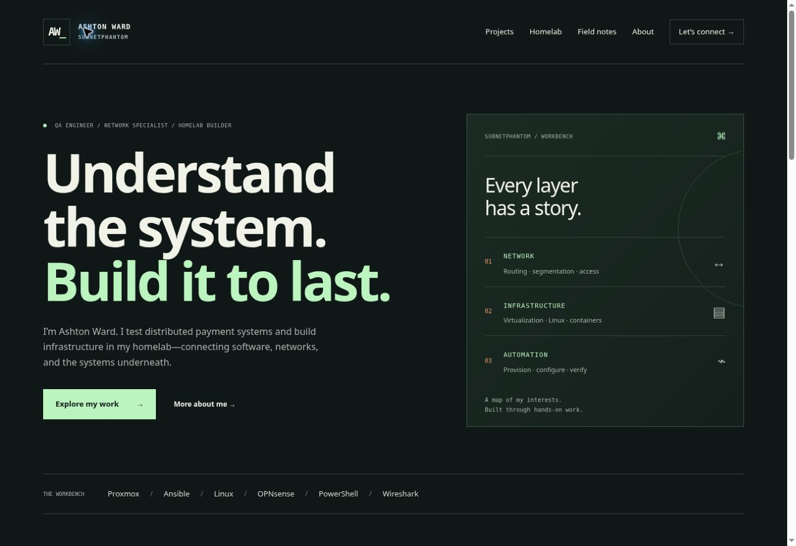

# Ashton Ward / SubnetPhantom — Portfolio

A static professional portfolio intended for **ashtonward.tech**, with source maintained in `AshtonWard/Portfolio`.

The rebuild is under review. The domain and production hosting have not been changed.



## Local development

Requires Python 3.10 or newer. No third-party packages or frontend build dependencies are needed.

```sh
python3 scripts/build.py
python3 scripts/check.py
python3 -m http.server 8000 --directory dist
```

Open http://localhost:8000. Rebuild after changing source files.

## Structure

- `index.html`: introduction and selected work
- `projects/`: automation, homelab, and Putler project overviews
- `homelab.html`: technical focus areas
- `notes.html` and `notes/`: field notes
- `about.html`: background, tools, and professional links
- `assets/`: local CSS, JavaScript, and SVG favicon
- `scripts/`: static packaging and local link checks
- `docs/content-review.md`: source inventory, findings, and remaining publication review
- `docs/launch-checklist.md`: hosting and launch work

The build copies an explicit list of current pages and assets into `dist/`. Legacy `Bio/`, `Education/`, `Experience/`, `PastProjects/`, `CurrentProjects/`, `Administrative/`, and root `index.css` / `index.js` remain available for historical reference but are excluded from the build. They are not part of the new navigation.

## Editing content

Edit the corresponding HTML page. Pages contain their own text and semantic markup; CSS and the small optional navigation enhancement are shared. Core content and navigation work with JavaScript disabled.

To add a project or field note:

1. Copy a sibling page and update its title, description, heading, and content.
2. Keep `../assets/` links on nested pages; use relative links so GitHub Pages project URLs work.
3. Add a descriptive link from the homepage or field-note index.
4. Explain implemented behavior, evidence, limitations, and planned work separately.
5. Run the build and link check; review desktop and mobile layouts before publishing.

If adding a top-level page, also add it to the explicit page list in `scripts/build.py`.

## Publishing

Upload only `dist/` to the selected static host. For GitHub Pages, use a Pages Actions deployment artifact containing this directory. Do not publish the repository root: it includes legacy content and review documents.

Deployment automation, the custom domain, HTTPS verification, and the final resume download remain tracked in issues #1–#4. No deployment workflow or `CNAME` has been enabled as part of this first draft.

## Content status

The first project pages are scoped overviews. At review time the public Ansible and Homelab repositories each contained only a README; the site does not describe their full implementations as publicly available. Project evidence and the current resume still need review before launch.
